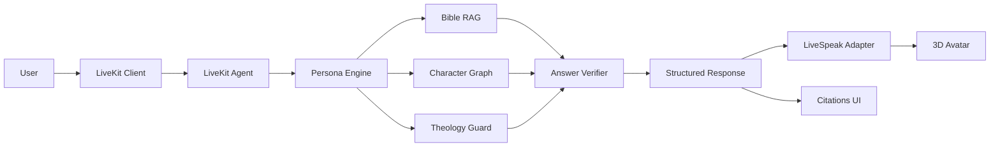

# 00 — System Architecture

## Bounded contexts

### 1. Character Domain
Owns canonical character identity, profile, relationships, event links, avatar and voice configuration.

### 2. Digital Human Runtime
Owns MetaPerson/LiveSpeak integration and speaking state. It knows nothing about theology.

### 3. Realtime Conversation
Owns LiveKit room/session lifecycle, microphone, STT, turn detection, interruption policy and delivery of user utterances.

### 4. Bible Intelligence
Owns Persona routing, Bible RAG, graph retrieval, citations, grounding and structured answer generation.

### 5. Assurance
Owns truth sets, citation validation, adversarial prompts, quality gates, release evidence and E-level.

## Data flow

## Runtime policy

- One canonical `characterId` per persona.
- The visible avatar and active persona must match.
- Any persona switch is atomic at the application level: load config → load model → update voice → update RAG/persona scope → mark ready.
- If model load fails, keep the previous character or fail closed; do not silently show character A while answering as character B.
